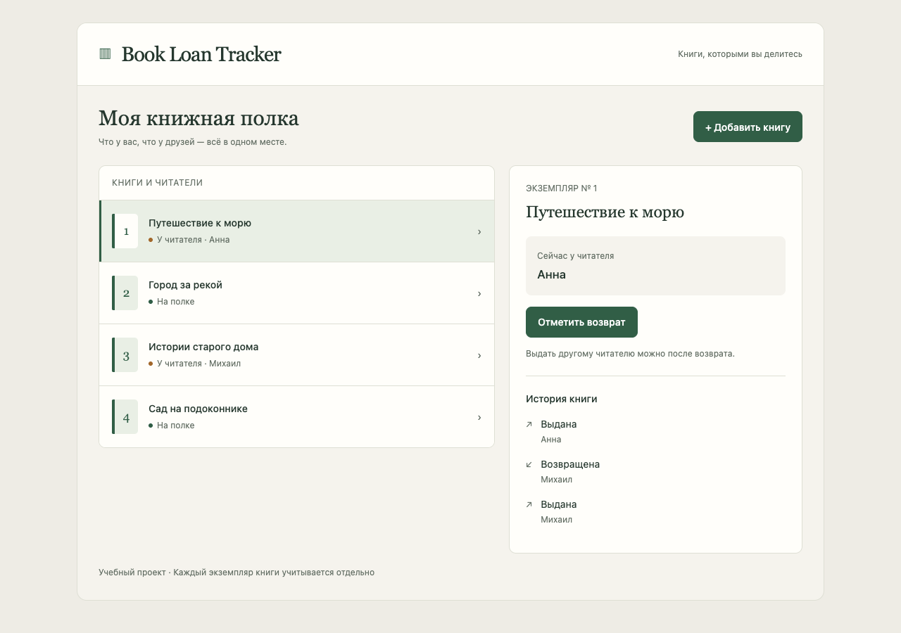

# Book Loan Tracker — учёт выдачи книг

Учебное веб-приложение для владельца небольшой книжной полки.
Помогает записать, кому выдана книга, и отметить её возврат.
Есть браузерный интерфейс и CLI — команды терминала для тех же операций.

Работают добавление книг, выдача, возврат и история.
Повторная выдача занятой книги отклоняется. Текущий читатель
и событие выдачи или возврата сохраняются вместе, в одной транзакции.

На скриншоте работающего приложения показаны учебные книги и имена.
[Попробовать сценарий](docs/demo.md) · [Локальный запуск и проверки](docs/development.md)
