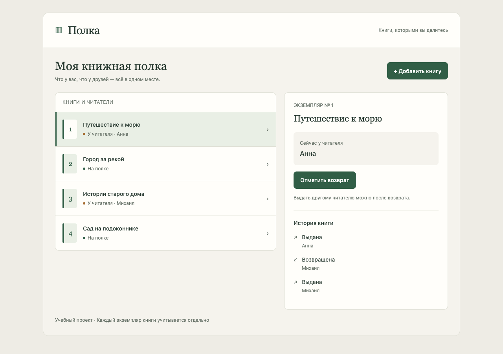
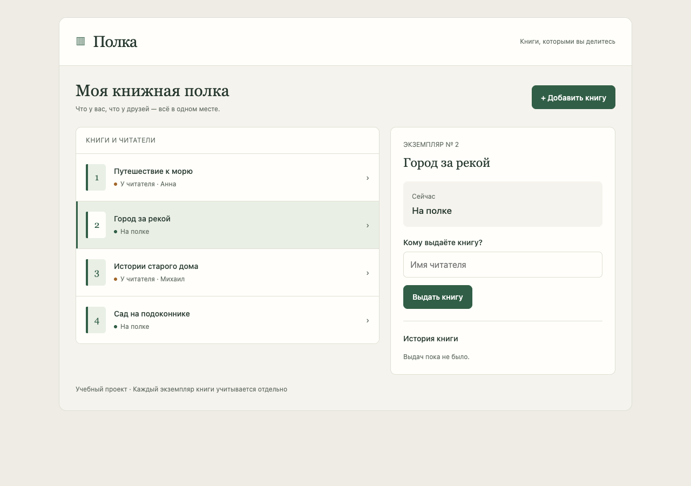
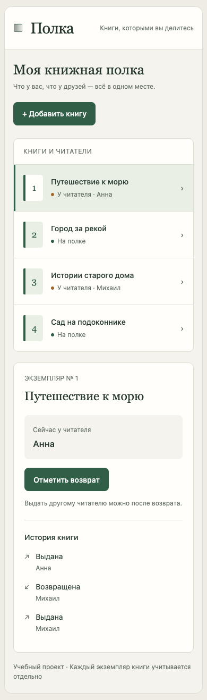

# Демонстрация и скриншоты

Все названия книг и имена ниже — учебные. Скриншоты сняты с работающего приложения,
а не с макета. Публичного сайта нет; используется локальный запуск.

## Подготовка

Запустите проект по [инструкции](development.md). Для кадра как в README используйте пустую базу
и команду `seed`: она добавляет «Путешествие к морю», «Город за рекой»,
«Истории старого дома» и «Сад на подоконнике».

Локально, в активированном окружении:

```bash
python -c "from pathlib import Path; Path('data').mkdir(exist_ok=True)"
python polka.py --db data/demo.db seed
POLKA_DB=data/demo.db python web.py
```

Если `data/demo.db` уже содержит записи, выберите другое имя. `seed` не очищает базу.

## Основной экран

Откройте http://localhost:8000/?book=1. Слева виден список, справа — Анна,
действие возврата и история выбранного экземпляра. Даты не показаны: программа их не сохраняет.



Для воспроизведения кадра: окно 1280 × 900, масштаб браузера 100%, светлая системная тема.
Сам интерфейс поддерживает светлую и тёмную тему по настройке браузера/ОС.

## Выдача и возврат

Откройте «Город за рекой». Укажите «Елена» и нажмите «Выдать книгу».
После обновления страницы имя должно сохраниться. Нажмите «Отметить возврат»,
подтвердите действие и проверьте историю: сначала была выдача, затем возврат.
В интерфейсе новые события показаны сверху.



Для проверки устаревшей формы откройте свободную книгу в двух вкладках.
Выдайте её в первой вкладке, затем отправьте вторую форму с другим именем.
Ожидается сообщение «Книга уже выдана»; первый читатель и история сохраняются.

Добавление: нажмите «Добавить книгу», введите название и сохраните.
Пустое название не принимается. У книг с одинаковым названием будут разные номера.

## Узкий экран

При ширине 390 пикселей список и сведения о книге располагаются друг под другом.



## Изолированное демо CLI

Команда не меняет выбранный файл данных и каждый раз использует отдельную базу в памяти:

```bash
python polka.py demo
```

Ожидаемый вывод:

```text
Добавлена книга: 1
Книга выдана: Читатель А
Повторная выдача отклонена: Книга уже выдана
Книга возвращена; событий в истории: 2
```

Отказ здесь — ожидаемая часть сценария, поэтому всё демо завершается с кодом 0.
Отдельная неудачная команда `lend` возвращает код 1.

## Ручная проверка сохранения через CLI

Используйте отсутствующий файл `practice.db`; если он уже есть, выберите другое имя.
Номер 1 в командах подходит для первой книги новой базы.

```bash
python polka.py --db practice.db add "Учебная книга"
python polka.py --db practice.db lend 1 "Читатель А"
python polka.py --db practice.db list
python polka.py --db practice.db lend 1 "Читатель Б"
```

Последняя команда должна завершиться с кодом 1 и сообщением «Книга уже выдана».
Выполните оставшиеся команды отдельно:

```bash
python polka.py --db practice.db list
python polka.py --db practice.db return 1
python polka.py --db practice.db history 1
```

После отказа книга по-прежнему у Читателя А. После возврата история содержит два события:
`lend`, затем `return`; отказ не добавляет событие. Команда `list` после возврата
покажет `borrower: null`, то есть отсутствие текущего читателя.
